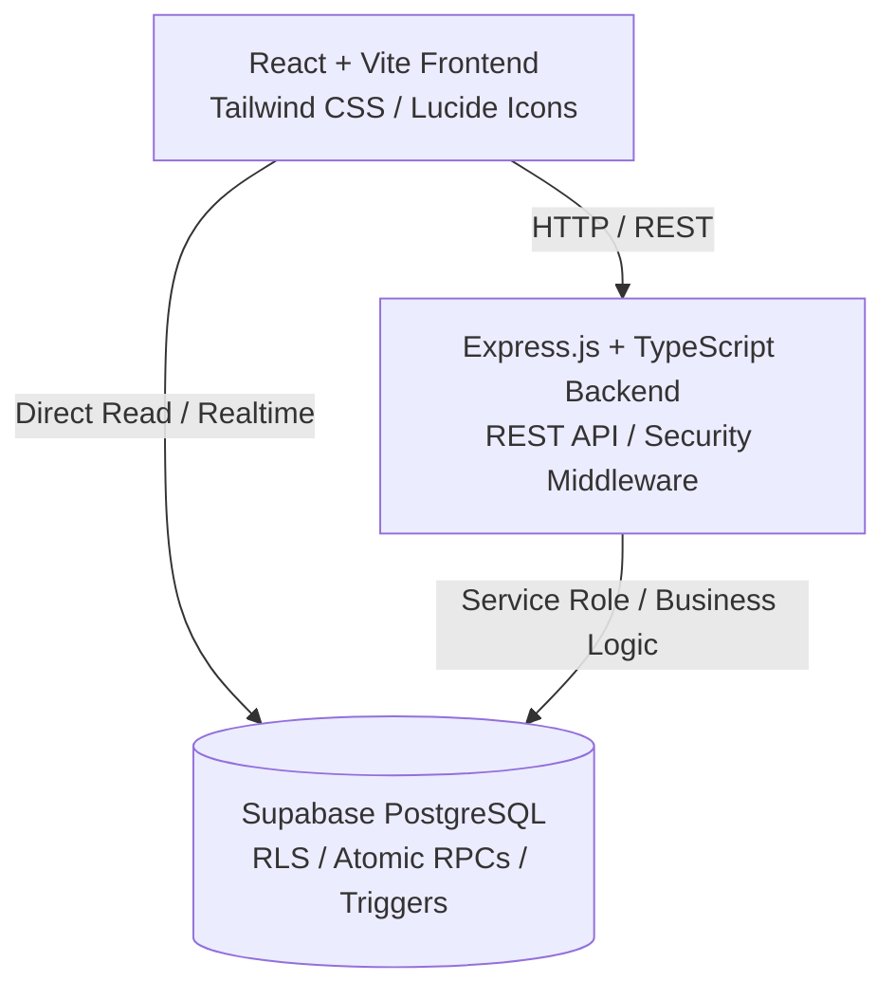

# FurniERP — Enterprise Furniture Manufacturing & Operations ERP


**FurniERP** is a full-featured Enterprise Resource Planning (ERP) platform purpose-built for bespoke furniture manufacturers, workshops, and retail showrooms. It seamlessly links the end-to-end furniture lifecycle: from customer quotation and deposit to production order scheduling, raw material consumption, quality inspection, showroom inventory, point-of-sale (POS) checkout, and double-entry financial reconciliation.

---

## 🌟 Key Modules & Capabilities

### 1. 🛋️ Product Catalog & Bill of Materials (BOM)
- Track both **Finished Goods** and **Raw Materials** (timber, fabrics, hardware, finishes).
- Multi-component Bills of Materials with automated material requirement calculations.
- Cost rollups factoring raw materials, labor, and workshop overheads.

### 2. 🏭 Manufacturing & Workshop Control
- **Production Orders (MO)**: Schedule, dispatch, and track custom and batch furniture builds.
- **Material Issue Slips**: Atomically deduct raw materials from inventory upon release to workshop.
- **Waste & Scrap Tracking**: Log material yield variance and scrap rates.
- **Automated Workflow**: Production completion automatically updates finished goods stock and signals order fulfillment.

### 3. 📦 Inventory & Stock Movement Ledger
- Real-time stock levels with multi-location awareness.
- Immutable inventory movement ledger (`PURCHASE_RECEIPT`, `PRODUCTION_ISSUE`, `PRODUCTION_OUTPUT`, `SALE_DEDUCTION`, `ADJUSTMENT`).
- Automated low-stock thresholds with proactive reorder alerts.

### 4. 💳 Sales, Custom Orders & POS
- **Rapid POS Checkout**: Barcode-friendly point-of-sale with instantaneous receipt generation.
- **Bespoke Custom Orders**: Accept custom furniture commissions with partial advance deposits.
- **Flexible Payment Terms**: Support for Cash, Bank Transfer, Check, and mobile payments (e.g., E-Birr).
- **Customer Balance Tracking**: Automatic computation of credit, partial payment, and outstanding balances.

### 5. 👥 Customer & Supplier Management
- Complete customer profiles with historical purchases, active custom orders, and debt ledgers.
- Supplier catalog with contact information, payment terms, and supply histories.

### 6. 📊 Financial Accounting & Reporting
- Real-time income and expense tracking categorized by account charts.
- Automated cash flow statements, sales summaries, and inventory valuation reports.
- Daily reconciliation comparing recorded cash/bank transactions against physical balances.

### 7. 🛡️ Security, Governance & Recovery Center
- **Role-Based Access Control (RBAC)**: Super Admin, Admin, Manager, Cashier, Workshop Manager, and Accountant roles.
- **Audit Logging**: Comprehensive, tamper-evident audit logs capturing user actions, timestamps, and payload snapshots.
- **Soft-Delete & Recovery Center**: Accidental deletions can be inspected and restored without data corruption.

---

## 🏗️ Architecture & Technology Stack



### Frontend
- **Framework**: [React 18](https://react.dev/) + [Vite](https://vitejs.dev/)
- **Language**: [TypeScript](https://www.typescriptlang.org/)
- **Styling**: [Tailwind CSS](https://tailwindcss.com/)
- **Icons**: [Lucide React](https://lucide.dev/)
- **State & UX**: Tab persistence (`visitedTabs`) preserving draft forms and table scroll states during navigation.

### Backend
- **Framework**: [Express.js](https://expressjs.com/)
- **Language**: TypeScript with strict typing
- **Architecture**: Modular routing (`/api/auth`, `/api/sales`, `/api/manufacturing`, `/api/finance`, etc.)
- **Security**: JWT verification, role permission guards, error middleware, and audit logging.

### Database & Cloud
- **Database**: [Supabase](https://supabase.com/) (PostgreSQL 15+)
- **Security**: Row Level Security (RLS) policies protecting tenant and operational data.
- **Integrity**: ACID-compliant Stored Procedures (RPCs) guaranteeing atomic multi-table transactions (e.g., `execute_sale_checkout`, `complete_production_order`).

---

## 📁 Repository Structure

```text
FurniERP/
├── backend/                  # Express.js REST API server
│   ├── src/
│   │   ├── config/           # Database and Supabase clients
│   │   ├── middleware/       # Auth, roles, error handling
│   │   ├── routes/           # Sales, Manufacturing, Finance, etc.
│   │   ├── services/         # Audit, reconciliation, business logic
│   │   └── server.ts         # Server entrypoint
│   ├── .env.example          # Backend environment template
│   └── tsconfig.json
│
├── frontend/                 # React + Vite Single Page Application
│   ├── src/
│   │   ├── components/       # Reusable UI components & tables
│   │   ├── contexts/         # Authentication and theme state
│   │   ├── pages/            # Dashboard, Sales, Inventory, Manufacturing, etc.
│   │   ├── services/         # Frontend API client
│   │   ├── App.tsx           # Main application layout & navigation
│   │   └── main.tsx          # React mounting root
│   ├── .env.example          # Frontend environment template
│   └── vite.config.ts
│
├── supabase/
│   └── migrations/           # Versioned PostgreSQL schema migrations
│
├── docs/                     # System architecture & workflow documentation
│   ├── BUSINESS_WORKFLOWS.md
│   ├── DATA_FLOW.md
│   ├── DB.md
│   ├── FINANCIAL_ARCHITECTURE_AUDIT.md
│   └── SYSTEM_AUDIT.md
│
├── .gitignore                # Global protection for secrets & artifacts
└── README.md
```

---

## 🚀 Quick Start Guide

### Prerequisites
- [Node.js](https://nodejs.org/) v18.0.0 or higher
- [npm](https://www.npmjs.com/) or [pnpm](https://pnpm.io/)
- A [Supabase](https://supabase.com/) project (Cloud or local via Supabase CLI)

### 1. Clone the Repository
```bash
git clone https://github.com/dally-ab1/furniture.git
cd furniture
```

### 2. Configure Backend Environment
Navigate to `backend/` and copy `.env.example`:
```bash
cd backend
cp .env.example .env
```
Fill in your Supabase connection parameters:
```env
PORT=5000
SUPABASE_URL=https://your-project.supabase.co
SUPABASE_ANON_KEY=your_supabase_anon_key
SUPABASE_SERVICE_ROLE_KEY=your_supabase_service_role_key
ALLOW_DEV_SUPER_ADMIN=false
```

Install dependencies and start the backend:
```bash
npm install
npm run dev
```
*The backend API will start on `http://localhost:5000`.*

### 3. Configure Frontend Environment
In a new terminal, navigate to `frontend/`:
```bash
cd frontend
cp .env.example .env
```
Provide the frontend Supabase keys:
```env
VITE_SUPABASE_URL=https://your-project.supabase.co
VITE_SUPABASE_ANON_KEY=your_supabase_anon_key
```

Install dependencies and run Vite:
```bash
npm install
npm run dev
```
*The web interface will be accessible at `http://localhost:5173`.*

---

## 🗄️ Database Setup & Migrations

Database migrations are located in `supabase/migrations/` in chronological order:

| Migration File | Description |
| :--- | :--- |
| `20261015000001_initial_schema.sql` | Core schema: users, products, inventory, sales, suppliers |
| `20261015000002_business_logic_rpcs.sql` | Atomic sale checkouts and stock deduction procedures |
| `20261015000003_manufacturing_and_payments.sql` | Production orders, BOM, and payments ledger |
| `20261015000004_operational_rls_policies.sql` | Row-Level Security rules |
| `20261015000005_fix_bootstrap_and_rls.sql` | Super Admin initial bootstrap configuration |
| `20261018000001_update_payment_method_ebirr.sql` | Support for regional payment providers (E-Birr) |
| `20261019000001_enhance_audit_logs.sql` | Detailed system change capture |
| `20261021000001_recovery_center_and_soft_delete.sql` | Soft-deletion architecture and restore mechanisms |
| `20261022000001_add_username_login.sql` | Support for username-based authentication |
| `20261023000001_customer_workflow_integration.sql` | Custom order deposit, production link, and delivery flow |

Execute these migrations using the Supabase Dashboard SQL Editor or via the Supabase CLI:
```bash
supabase db push
```

---

## 🔒 Security & Best Practices

- **Zero Secret Exposure**: `.env` files, private API keys, and service role credentials are excluded from version control via `.gitignore`.
- **Atomic Operations**: Financial transactions and stock deductions run inside database-level transactions to eliminate race conditions and orphaned records.
- **Tamper-Resistant Audits**: Every critical creation, update, and deletion is recorded with the active user identity.

---

## 📄 License

This project is licensed under the [MIT License](LICENSE).
