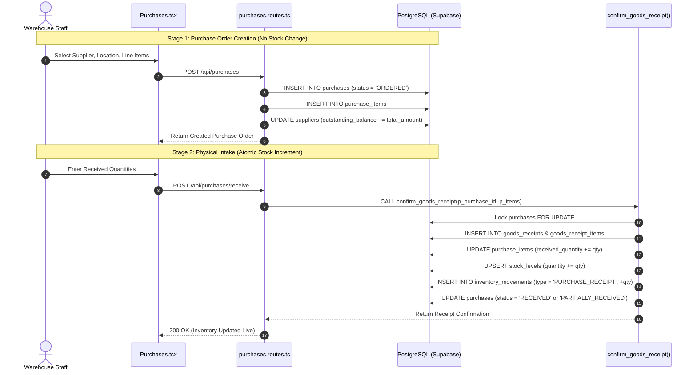
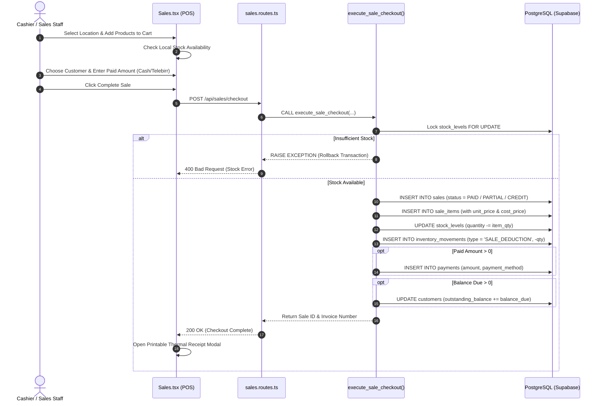
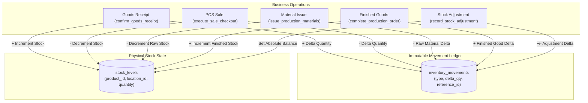
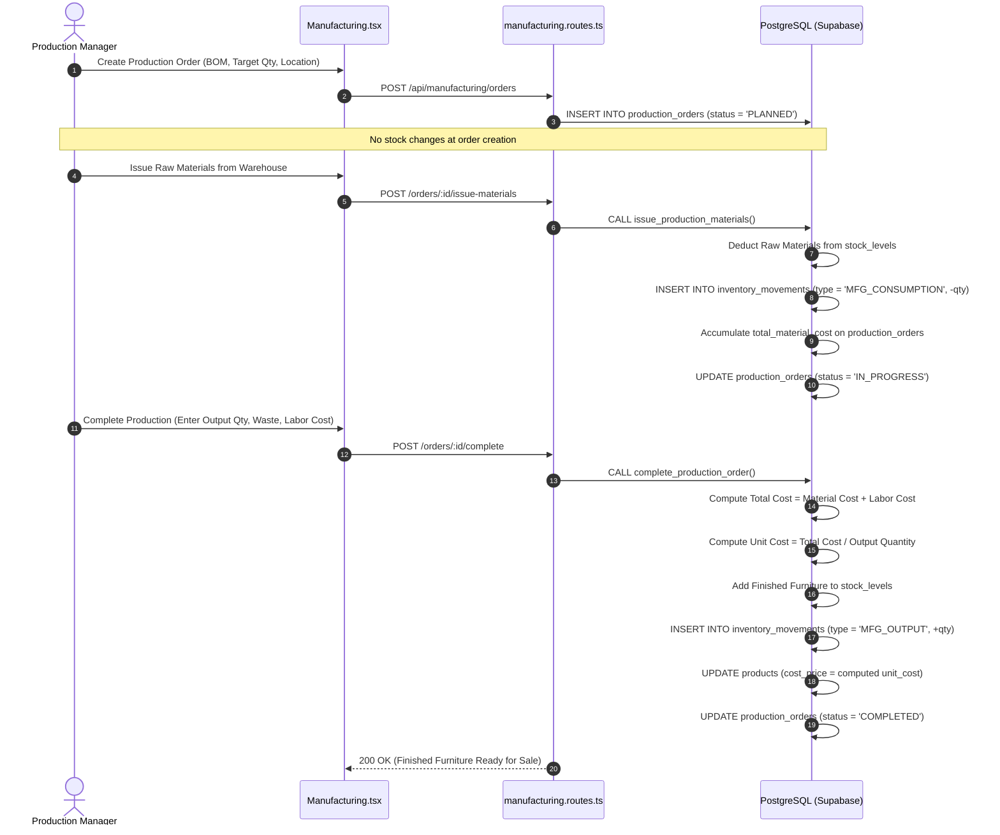
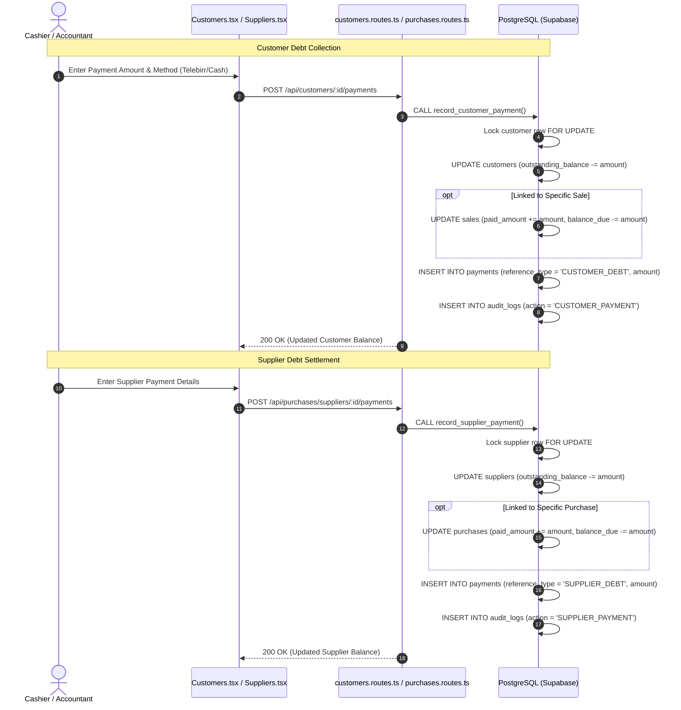
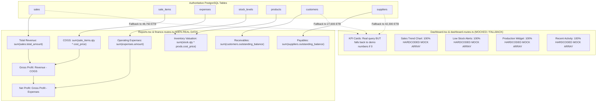
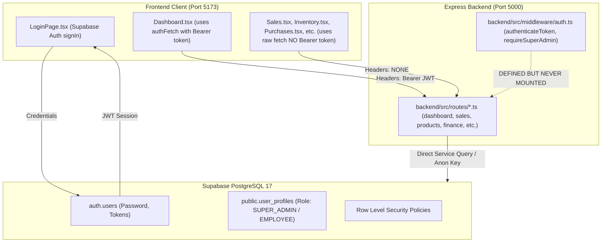

# BUSINESS_WORKFLOWS.md — FurniERP Business Workflow & Architecture Diagrams

This document illustrates the actual end-to-end data flows and component interactions implemented in FurniERP.

---

## 1. Purchase and Goods Receipt Workflow

---

## 2. POS Sale and Payment Workflow

---

## 3. Inventory Movement and Stock Balances

---

## 4. Manufacturing and Production Costing Workflow

---

## 5. Customer and Supplier Debt Settlement Workflow

---

## 6. Dashboard vs Financial Reports Data Source Reality

---

## 7. Authentication & Authorization Enforcement Reality

