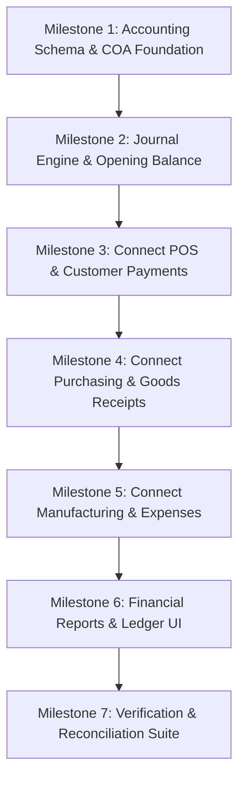

# FurniERP — Financial Architecture Audit & Implementation Plan

**Date:** October 18, 2026  
**Auditor:** Antigravity AI Pair Programmer  
**System:** FurniERP (Ethiopian Furniture Retail & Manufacturing)  
**Database:** Supabase PostgreSQL 17 (`jbatiogfgozpktnraezn`)  
**Currency:** Ethiopian Birr (ETB)  
**Current Architecture:** React + TypeScript (Vite), Express + TypeScript, Supabase PostgreSQL with RLS & Atomic RPCs.

---

## 1. Executive Summary

FurniERP currently possesses robust **operational transaction tracking** (atomic POS checkout, atomic inventory deduction/receipt, physical inventory movements, customer/supplier debt tracking, and atomic manufacturing material issues/intakes). 

However, **it does not have a true financial accounting engine**:
- **No Chart of Accounts (COA):** Accounts are represented as hardcoded string enums or disparate table columns.
- **No Double-Entry General Ledger (GL):** Transactions do not generate balanced debits and credits ($\sum \text{Debits} = \sum \text{Credits}$).
- **No Journal Entries or Lines:** There is no journal table or persistent accounting entry trail.
- **No Accounting Periods:** Transactions can be posted at any date with no lock dates or closed-period controls.
- **Dynamic Aggregation instead of Ledger Reporting:** All P&L, balance sheet, and revenue figures in `Reports.tsx` and `finance.routes.ts` are computed on the fly by querying operational document tables (`sales`, `sale_items`, `expenses`, `payments`, `stock_levels`).
- **Accounting Inconsistencies:** 
  1. Creating a Purchase Order increments `supplier.outstanding_balance` immediately, prior to goods receipt or bill verification.
  2. Operating expenses do not deduct cash or bank balances from any account.
  3. Manufacturing consumes materials and records standard cost on the product, but does not track Work-In-Progress (WIP) or labor accrual in the balance sheet.
  4. Seed data contains historical customer and supplier balances without source invoices or balancing equity entries.

---

## 2. Transaction-by-Transaction Financial Tracing

| Business Event | Current Operational Implementation | Actual Financial / Ledger Effects Occurring | Missing Accounting Effects (Required by Odoo/ERP Standard) |
| :--- | :--- | :--- | :--- |
| **POS Cash Sale** | `execute_sale_checkout` RPC: locks stock, deducts `stock_levels`, inserts `inventory_movements` (`SALE_DEDUCTION`), inserts `sales`, `sale_items`, and `payments` (`SALE`). | `sales.paid_amount` updated; `payments` record created; inventory qty reduced. | **Missing balanced entry:** • Dr. Cash on Hand (Main Shop / Warehouse) • Cr. Sales Revenue • Dr. Cost of Goods Sold (COGS) • Cr. Inventory — Finished Goods |
| **POS Credit / Partial Sale** | `execute_sale_checkout` RPC: calculates `balance_due = total - paid`; updates `customers.outstanding_balance`; inserts `payments` for deposit. | Customer balance incremented; `sales.balance_due` set; stock deducted. | **Missing balanced entry:** • Dr. Cash on Hand (for deposit) • Dr. Accounts Receivable Control (for balance due) • Cr. Sales Revenue (gross amount) • Dr. COGS • Cr. Inventory — Finished Goods |
| **Customer Debt Collection** | `record_customer_payment` RPC: locks customer row, decrements `customers.outstanding_balance`, optionally updates `sales.paid_amount`, inserts `payments` (`CUSTOMER_DEBT`). | Customer balance decreased; payment logged. | **Missing balanced entry:** • Dr. Cash / Bank / Telebirr account • Cr. Accounts Receivable Control Account |
| **Purchase Order Creation** | `POST /api/purchases`: inserts `purchases` and `purchase_items`; updates `suppliers.outstanding_balance`. | **Flawed:** Increases supplier debt before delivery or invoice. | **Accounting Correction:** A Purchase Order is a non-posting commitment. It should NOT touch Accounts Payable or General Ledger. |
| **Goods Receipt (GRN)** | `confirm_goods_receipt` RPC: inserts `goods_receipts`, increments `stock_levels`, inserts `inventory_movements` (`PURCHASE_RECEIPT`). | Physical stock qty increased. | **Missing balanced entry:** • Dr. Inventory — Raw Materials (or Finished Goods) • Cr. Goods Received Not Invoiced (GRNI / Clearing) or Accounts Payable |
| **Supplier Bill / Payment** | `record_supplier_payment` RPC: decrements `suppliers.outstanding_balance`, updates `purchases.paid_amount`, inserts `payments` (`SUPPLIER_DEBT`). | Supplier balance decreased; payment record inserted. | **Missing balanced entry:** • Dr. Accounts Payable Control Account • Cr. Bank Account / Cash Account |
| **Production: Material Issue** | `issue_production_materials` RPC: deducts raw material `stock_levels`, records negative `inventory_movements` (`MFG_CONSUMPTION`), updates `production_orders.total_material_cost`. | Raw stock decremented; order cost accumulated. | **Missing balanced entry:** • Dr. Work in Progress (WIP) — Material • Cr. Inventory — Raw Materials |
| **Production: Order Completion** | `complete_production_order` RPC: increments finished good `stock_levels`, records positive `inventory_movements` (`MFG_OUTPUT`), updates `products.cost_price`. | Finished stock incremented; product cost updated. | **Missing balanced entry:** • Dr. Inventory — Finished Goods • Cr. Work in Progress (WIP) — Material • Cr. Direct Labor Applied / Accrued Payroll |
| **Operating Expense** | `POST /api/finance/expenses`: inserts into `expenses` table (`category`, `amount`, `payment_method`, `date`). | Expense row saved. | **Missing balanced entry:** • Dr. Operating Expense (Rent, Utilities, Transport, etc.) • Cr. Cash / Bank / Mobile Money (Cash outflow actually credited) |
| **Stock Adjustment** | `record_stock_adjustment` RPC: updates `stock_levels`, records `inventory_movements` (`MANUAL_ADJUSTMENT`). | Stock qty altered with audit reason. | **Missing balanced entry:** • Dr/Cr. Inventory Asset (Raw / Finished) • Cr/Dr. Inventory Shrinkage / Gain Expense Account |

---

## 3. Detailed Gap Analysis

### 3.1 Chart of Accounts
- Currently, FurniERP has **no accounts table**.
- Payment methods (`CASH`, `BANK_TRANSFER`, `TELEBIRR`, `CBE_BIRR`) are hardcoded text strings in `payments` and `expenses`.
- There are no account codes (e.g. `1010 Cash on Hand`, `1020 CBE Bank`, `1030 Telebirr`, `1200 Accounts Receivable`, `1310 Raw Materials`, `1320 Finished Goods`, `2010 Accounts Payable`, `3010 Owner Equity`, `4010 Sales Revenue`, `5010 COGS`, `6010 Rent Expense`).

### 3.2 Double-Entry General Ledger Engine
- There are no tables for `journal_entries` or `journal_entry_lines`.
- No debit and credit tracking.
- Zero mathematical guarantee that assets equal liabilities plus equity ($A = L + E$).
- If a report is run, it synthesizes totals from raw document tables; if any operational row is modified or omitted, reports change without an audit trail.

### 3.3 Accounting Periods & Locking
- There is no concept of fiscal years or closed accounting months.
- Users can post or backdate expenses and transactions into any period without restriction.

### 3.4 Transaction Reversals
- When a sale is cancelled (`status = 'CANCELLED'`), it is simply excluded via `.neq('status', 'CANCELLED')` in SQL queries.
- In a professional ERP, transactions are never erased or ignored: an explicit **Credit Note / Reversal Journal Entry** must be posted to reverse revenue, receivable, and inventory movements.

### 3.5 Payment Allocation
- `record_customer_payment` accepts an optional `p_sale_id`. When omitted, it decrements `customers.outstanding_balance`, but leaves specific sales invoices with `balance_due > 0`. This makes invoice-level Accounts Receivable aging disjointed from customer-level balances.

---

## 4. Live Data Audit & Migration Risks

Inspection of the live Supabase PostgreSQL database (`jbatiogfgozpktnraezn`) on October 18, 2026 revealed:

1. **Sales Table:**
   - 4 sales recorded (`INV-00001` through `INV-00004`).
   - Total Gross Revenue: **ETB 97,000.00**.
   - Total COGS across items: **ETB 25,630.00**.
   - Balance due recorded across sales: **ETB 45,200.00**.
2. **Payments Table:**
   - 5 payment records totaling **ETB 23,300.00**.
   - Breakdown: 3 Sale checkouts (ETB 13,800.00), 1 Customer debt settlement (ETB 5,000.00), 1 Supplier debt payment (ETB 4,500.00).
3. **Customers:**
   - 5 customer records with total outstanding balance of **ETB 56,000.00**.
   - Unsettled sales invoices total **ETB 45,200.00**.
   - Seeded opening historical debt (unlinked to an invoice): **ETB 10,800.00** (Mekdes Tadesse ETB 3,600 opening balance, Daniel Girma ETB 7,200 opening balance).
4. **Suppliers:**
   - 4 suppliers with total outstanding balance of **ETB 37,800.00** (Addis Paint ETB 17,800, Ethio Timber ETB 20,000).
   - `purchases` table currently has 0 rows. All supplier balances originated from database seeding without POs or supplier invoices.
5. **Inventory:**
   - 15 stock level records across Main Shop and Central Warehouse totaling **ETB 668,835.00** in asset valuation.
6. **Manufacturing:**
   - 1 completed order (`MO-00001`): Material cost ETB 13,130.00, Labor cost ETB 1,500.00. Finished 2 dining tables.
7. **Expenses:**
   - 1 expense record: ETB 1,200.00 (Workshop Supplies via Telebirr).

### Data Migration Risks
- **Risk 1 (Historical Discrepancy):** Fabricating artificial historical journal entries for pre-existing seed data could corrupt balances or conflict with past operational logs.
- **Risk 2 (Duplicate Impact):** If we apply journal posting retroactively without an opening balance boundary, current P&L metrics could double-count.
- **Risk 3 (Supplier PO Pre-debt):** The existing `purchases.routes.ts` increments supplier balance on PO creation. If we introduce an Accounts Payable journal entry on Goods Receipt or Supplier Bill, supplier debt would be counted twice.
- **Safe Migration Policy:**
  - Create a formal **Opening Balance Journal Entry** for historical inventory valuation, customer receivables, supplier payables, and balancing owner equity as of an initialization cutoff date.
  - Fix the PO creation logic so that PO creation does not prematurely increment supplier balance; only confirmed Goods Receipts / Supplier Invoices post to AP.
  - Enable live double-entry posting for all new transactions while preserving legacy table synchronization.

---

## 5. Staged Implementation Plan

### Milestone 1 — Core Accounting Foundation (Safe Milestone)
1. **Version-controlled SQL Migration:**
   - `chart_of_accounts` table: hierarchical account code, name, type (`ASSET`, `LIABILITY`, `EQUITY`, `INCOME`, `EXPENSE`), subtype, active flag, initial balance.
   - `accounting_periods` table: fiscal year, period name, start date, end date, is_closed flag, closed_by.
   - `journal_entries` table: entry number, date, period_id, reference_type (`SALE`, `PURCHASE`, `PAYMENT`, `EXPENSE`, `MANUFACTURING`, `MANUAL`, `OPENING_BALANCE`), reference_id, description, status (`DRAFT`, `POSTED`, `CANCELLED`), created_by.
   - `journal_lines` table: entry_id, account_id, debit (`NUMERIC(14, 2)`), credit (`NUMERIC(14, 2)`), description, partner_type (`CUSTOMER`, `SUPPLIER`), partner_id.
   - Check constraints: `debit >= 0`, `credit >= 0`, `(debit > 0 AND credit = 0) OR (credit > 0 AND debit = 0)`.
   - Atomic database trigger / constraint: Enforce **Total Debits = Total Credits** on posted entries.
2. **Standard Ethiopian Furniture Chart of Accounts:**
   - 1010: Cash on Hand — Main Shop
   - 1020: Cash on Hand — Central Factory
   - 1030: Commercial Bank of Ethiopia (CBE)
   - 1040: Telebirr Merchant Account
   - 1050: CBE Birr Account
   - 1200: Accounts Receivable (Debtors Control)
   - 1310: Inventory — Raw Materials
   - 1320: Inventory — Work In Progress (WIP)
   - 1330: Inventory — Finished Furniture
   - 2010: Accounts Payable (Creditors Control)
   - 2020: Accrued Payroll & Direct Labor
   - 2030: Customer Advances / Prepayments
   - 3010: Owner Capital / Retained Earnings
   - 4010: Sales Revenue — Retail Furniture
   - 4020: Sales Revenue — Custom Manufacturing
   - 4090: Sales Discounts
   - 5010: Cost of Goods Sold (COGS)
   - 5020: Manufacturing Overhead Allocated
   - 6010: Rent Expense
   - 6020: Utilities Expense (Electricity & Water)
   - 6030: Workshop Supplies & Consumables
   - 6040: Transport & Delivery Expense
   - 6050: Maintenance & Repairs
   - 6090: Miscellaneous Operating Expense

### Milestone 2 — Posting Service & Opening Balance Journal Entry
- Centralized backend posting helper in Express (`backend/src/services/accounting.service.ts`).
- Secure SQL function `post_journal_entry` to guarantee atomic insertion and balance enforcement.
- Generate an audited `OPENING_BALANCE` entry matching verified live data:
  - Dr. Inventory Raw Materials + Finished Goods: ETB 668,835.00
  - Dr. Accounts Receivable (Historical): ETB 56,000.00
  - Cr. Accounts Payable (Historical): ETB 37,800.00
  - Cr. Owner Equity / Retained Earnings: Balancing figure (ETB 687,035.00).

### Milestone 3 — Integrate POS Sales, Credit Sales & Collections
- Update `execute_sale_checkout` to post balanced journal lines:
  - Dr. Cash/Telebirr/CBE account (amount paid)
  - Dr. Accounts Receivable (balance due)
  - Cr. Sales Revenue (total amount)
  - Dr. Cost of Goods Sold (total cost)
  - Cr. Inventory Finished Goods (total cost)
- Update `record_customer_payment` to post:
  - Dr. Receiving Cash/Bank/Telebirr account
  - Cr. Accounts Receivable

### Milestone 4 — Integrate Purchases, Goods Receipts & Supplier Payments
- Fix `POST /api/purchases`: PO creation becomes non-posting commitment.
- Update `confirm_goods_receipt` to post:
  - Dr. Inventory Raw Materials
  - Cr. Accounts Payable
- Update `record_supplier_payment` to post:
  - Dr. Accounts Payable
  - Cr. Bank / Cash account

### Milestone 5 — Integrate Manufacturing, Expenses & Adjustments
- Update `issue_production_materials` to post:
  - Dr. Inventory — WIP
  - Cr. Inventory — Raw Materials
- Update `complete_production_order` to post:
  - Dr. Inventory — Finished Furniture
  - Cr. Inventory — WIP (material cost)
  - Cr. Accrued Labor / Direct Labor (labor cost)
- Update `POST /api/finance/expenses` to post:
  - Dr. Specific Expense Account
  - Cr. Payment Source Account (Cash/Telebirr/Bank)
- Update `record_stock_adjustment` to post inventory asset vs. inventory shrinkage/gain.

### Milestone 6 — Odoo-Style Financial Reports & General Ledger UI
- Extend existing `Reports.tsx` without destroying existing layout:
  - Add sub-tabs: **Overview & P&L**, **Balance Sheet**, **Trial Balance**, **General Ledger**, **Journal Entries**, **AR/AP Aging**, **Chart of Accounts**.
  - General Ledger drilldown to individual journal entries and source documents.
  - Date filtering, CSV export.

### Milestone 7 — Reconciliation, Automated Tests & Verification
- Cross-check GL control accounts against operational subledgers.
- Automated tests verifying debit/credit equality, closed-period rejection, and reversal idempotency.

---

## 6. Immediate First Safe Milestone

We now proceed with **Milestone 1**:
1. Create version-controlled migration `20261018000001_accounting_foundation.sql`.
2. Define `chart_of_accounts`, `accounting_periods`, `journal_entries`, `journal_lines`, and balance triggers.
3. Seed the standard Ethiopian furniture chart of accounts and active 2026 fiscal year.
4. Verify migration application and zero regressions on existing tables.
